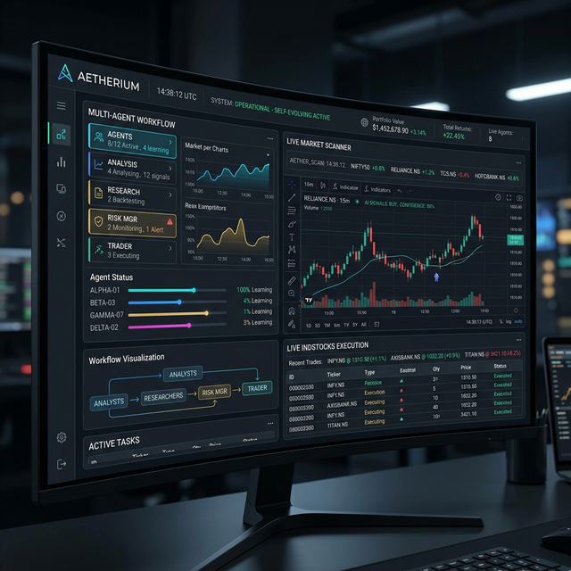
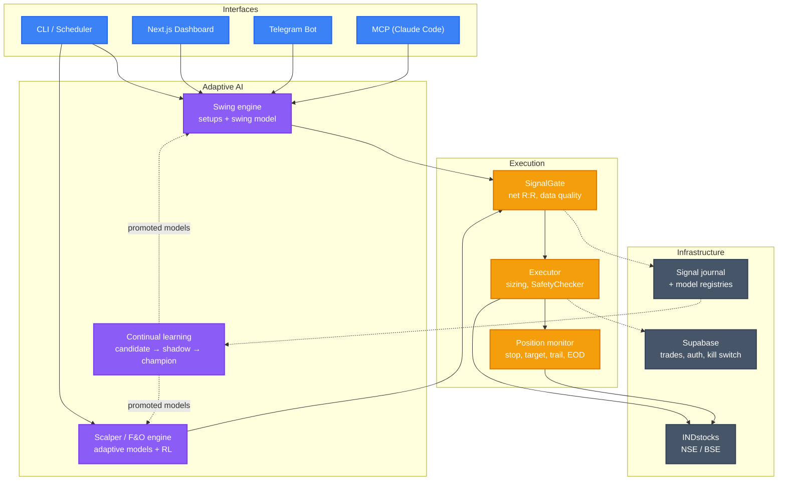
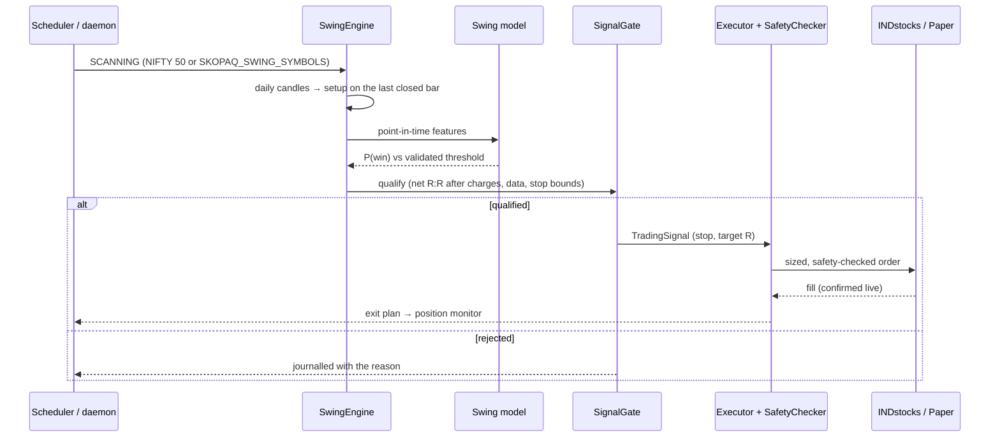

<div align="center">


# SkopaqTrader

**An open-source algorithmic trading platform for Indian equities — one AI: the Adaptive AI**

[](LICENSE)
[](https://python.org)

</div>

> [!CAUTION]
> **IMPORTANT LEGAL DISCLAIMER**
>
> This software is provided **strictly for educational and research purposes only**. It is **NOT** financial advice, investment advice, or trading advice of any kind.
>
> - **No guarantees of profit.** Algorithmic trading involves substantial risk of financial loss. Past performance does not guarantee future results.
> - **You are solely responsible** for any trades executed using this software, whether in paper or live mode.
> - **The authors and contributors are not** registered investment advisors, broker-dealers, or financial planners under SEBI, SEC, or any regulatory body.
> - **Use at your own risk.** By using this software, you acknowledge that you understand the risks of automated trading and accept full responsibility for all outcomes.
>
> *If you need financial advice, consult a SEBI-registered investment advisor.*

---

## Overview

SkopaqTrader trades NSE stocks and index options through the INDstocks broker with **one decision-maker: the Adaptive AI** — machine-learning models trained on its own market data, signals and trades. There is **no LLM and no API AI**: no API keys for AI providers, no per-call cost, and every model can be retrained, tested on unseen dates, shadowed on paper and promoted by an admin.

**Key capabilities:**

- **Swing book (Adaptive AI)** — daily setups (trend pullback, breakout, oversold bounce) with an ATR stop and an R-multiple target, scored by a swing model trained on the setups' historical outcomes **net of charges**. `skopaq swing-train`, `skopaq scan`.
- **Intraday scalper & F&O engine** — rule strategies plus adaptive models (LightGBM, XGBoost, CatBoost, random forest, MLP, FT-Transformer) and RL policies (PPO / A2C / DQN) as gates and strategies.
- **Continual learning with gates** — every model is a candidate until it beats the baseline on unseen data (profit factor, expectancy CI, drawdown, Brier); a shadow until an admin promotes it after the shadow period; rollback any time. Bundles are pickle-free with a SHA-256 manifest.
- **No-code strategies** — build feature/target specs on the dashboard's AI learning page.
- **Signal gate** — every entry from every book: net reward/risk after charges, data quality, stop bounds; journalled as QUALIFIED / REJECTED for the learning loop.
- **Safety first** — immutable `SafetyRules`, ATR position sizing, regime and event-calendar scaling, daily/weekly/monthly loss limits, a kill switch obeyed everywhere, paper by default. No model can change a hard limit.
- **Live order handling** — fills confirmed against the INDstocks order book, protective exits worked until filled, per-symbol SELL locks, an order journal that survives restarts.
- **Autonomous daemon + scheduler** — PRE_OPEN → SCANNING → ANALYZING → TRADING → MONITORING → CLOSING → REPORTING, one session per NSE trading day.
- **Mobile-first dashboard** — trading-style UI: candle charts, watchlist, positions, Trade desk, swing scanner, AI learning, track record.
- **Telegram & MCP** — alerts, `/ideas`, `/halt`; 26 MCP tools for Claude Code that read data and report the Adaptive AI's output.



> **Reminder:** See the [full disclaimer](#important-legal-disclaimer) at the top. This is a research tool, not a trading recommendation system.

## 🏗️ Architecture



### How a swing trade happens



Details: [Trading Pipeline](docs/architecture/pipeline.md) · [Swing Trading](docs/trading/swing-trading.md) · [Adaptive AI](docs/architecture/adaptive-ai.md) · [Execution safety](docs/architecture/execution-safety.md).

### Blockchain Infrastructure

SkopaqTrader includes **experimental** blockchain modules for crypto (`SKOPAQ_ASSET_CLASS=crypto`). They are covered by tests but not yet wired into the trading pipeline: there is no live crypto order path.

| Feature | Module | Description |
|---------|--------|-------------|
| **Live Trading** | `skopaq/broker/binance_auth.py` | Authenticated Binance API for spot trading with API keys |
| **Real-Time Feeds** | `skopaq/broker/binance_ws.py` | WebSocket streams for ticker, trades, order book, klines |
| **Gas Oracle** | `skopaq/blockchain/gas.py` | ETH, Polygon, Arbitrum, Optimism gas prices + tx cost estimates |
| **Whale Alerts** | `skopaq/blockchain/whales.py` | Large transaction monitoring for BTC, ETH, SOL |
| **Multi-Exchange** | `skopaq/broker/exchange.py` | Unified abstraction layer (Binance, Coinbase, Kraken) |

## Installation

### Prerequisites

- Python 3.11+
- An INDstocks (INDmoney) account with an API token for market data and live trading
- No AI/LLM API key

### Setup

```bash
git clone https://github.com/Tophunt-max/Ai-IND-money-.git
cd Ai-IND-money-

python -m venv .venv
source .venv/bin/activate  # macOS/Linux

pip install -e ".[dev]"     # add the ML extras you want (LightGBM etc.); `linear` needs none

cp .env.example .env        # INDstocks token, Supabase, Telegram (all optional for paper)
```

See [`.env.example`](.env.example) for every setting.

## Usage

> [!WARNING]
> All trading commands (live or paper) are **at your own risk**. Models can be wrong. Always verify positions manually and never risk capital you cannot afford to lose.

### CLI

```bash
skopaq status                          # System health check

# Adaptive AI: swing model
skopaq swing-train                     # Train on daily history (registers a candidate or shadow; no orders)
skopaq swing-status                    # Champion / shadow and test results
skopaq scan --limit 10                 # Today's swing ideas (setup, entry/stop/target, P(win)); no orders
skopaq swing-promote VERSION --by NAME --reason TEXT   # Shadow → champion (after the shadow period)
skopaq swing-rollback --by NAME --reason TEXT          # Back to the previous champion

# Autonomous daemon (scan → gate → trade → monitor → close)
# WARNING: The daemon trades autonomously. Use paper mode until you are confident.
skopaq daemon --once --paper           # Single paper session, now
skopaq daemon --dry-run                # Scan only, print the ideas, exit
skopaq schedule --check                # The scheduler's plan

# Intraday books (paper by default)
skopaq scalp                           # Intraday scalper until 15:10
skopaq fno                             # Index options buying until 15:10
skopaq adaptive-train                  # Train an adaptive (intraday) model
skopaq rl-train --algo ppo             # Train an RL policy

skopaq monitor                         # Monitor open positions until EOD
skopaq report --days 90                # Track record: journalled signals, closed trades
skopaq halt "broker outage"            # Kill switch: reject every BUY everywhere
skopaq resume                          # Lift it
skopaq serve --port 8000               # API server
skopaq token set <your-token>          # INDstocks token
```

## Claude Code Integration (MCP + Skills)

The MCP server (`skopaq/mcp_server.py`) exposes **26 tools** to Claude Code or any MCP client: quotes, candles, portfolio, `swing_ideas` / `swing_idea` (the Adaptive AI's output), `check_safety`, `place_order` (paper engine only), the kill switch, backtests and the track record. The decisions stay with the Adaptive AI; the skills report them and never invent a verdict.

Register it in `~/.claude.json` (or `.claude/.mcp.json`):

```json
{
  "mcpServers": {
    "skopaq": {
      "command": "python3",
      "args": ["-m", "skopaq.mcp_server"]
    }
  }
}
```

| Skill | What it does |
|-------|-------------|
| `/quote RELIANCE` | Real-time quote |
| `/analyze TCS` | The Adaptive AI's setup and P(win) for one stock, with indicators |
| `/scan` | Today's swing ideas |
| `/portfolio` | Positions, holdings, funds, P&L |
| `/trade INFY` | Paper-trade the Adaptive AI's setup after a safety check and your confirmation |
| `/options NIFTY` | Rule-based option-selling idea |

More: [docs/claude-code](docs/claude-code/setup.md).

## Project Structure

```
Ai-IND-money-/
├── tradingagents/              # Vendored data layer (TradingAgents v0.5.2 dataflows only)
│   └── dataflows/              # Vendored data layer; NSE/BSE data comes from INDstocks only
│
├── skopaq/
│   ├── adaptive/               # Adaptive AI: feature pipeline, models, bundles, RL, hyperopt
│   ├── swing/                  # Swing setups, swing model + registry, SwingEngine
│   ├── learning/               # Datasets, model registry + gates, continual learning, reports
│   ├── strategy/               # SignalGate, qualification rules, signal journal, selector
│   ├── scalping/               # Intraday scalper, F&O engine, backtests
│   ├── execution/              # Executor, safety checker, order router, live orders, daemon, monitor
│   ├── risk/                   # ATR sizing, regime detection, drawdown, event calendar
│   ├── broker/                 # INDstocks REST/WebSocket + Binance + paper engine
│   ├── api/                    # FastAPI backend (dashboard API)
│   ├── cli/                    # Typer CLI
│   ├── db/                     # Supabase client + repositories
│   ├── mcp_server.py           # MCP server (26 tools)
│   ├── telegram_bot.py         # Telegram bot
│   ├── config.py               # Pydantic Settings (env_prefix="SKOPAQ_")
│   └── constants.py            # Immutable safety rules + daemon variants
│
├── frontend/                   # Next.js dashboard (Vercel)
├── supabase/                   # Database migrations
├── docker/                     # Container entrypoint
├── .claude/                    # Claude Code skills + MCP registration
├── tests/                      # 1,700+ unit tests (no API keys) + integration tests
├── docker-compose.yml          # Always-on stack: api + telegram + scheduler
└── Dockerfile                  # One image: compose, Fly, Railway
```

## Security

- **No secrets in the repository.** All tokens and credentials are loaded from environment variables via `.env` (gitignored).
- **INDstocks tokens** are stored Fernet-encrypted in `~/.skopaq/token.enc` (mode 0600) and validated before every session. By default the key sits beside it in `token.key`; set `SKOPAQ_TOKEN_ENCRYPTION_KEY` to keep the key off that volume.
- **Broker endpoints are locked** — the INDstocks/Binance base and WebSocket URLs cannot be changed from the dashboard, so the token and MPIN/TOTP cannot be redirected to another host.
- **Fail-closed kill switch** — in live mode an unreadable Supabase halt flag halts new BUYs.
- **Immutable safety rules** in `skopaq/constants.py` enforce position limits, order value caps and rate limits that cannot be overridden at runtime — by settings or by any model.
- **Model bundles** load only after their SHA-256 manifest verifies; nothing is unpickled.
- **Live trading double-gate** — live sessions need `--live --confirm-live` (or the scheduler's `SKOPAQ_SCHEDULER_CONFIRM_LIVE`), and swing entries need an admin-promoted champion.

If you discover a security issue, please report it privately rather than opening a public issue.

## Testing

```bash
python -m pytest tests/unit/ -q                       # 1,700+ tests, no API keys
python -m pytest tests/integration/ -v -m integration # real broker calls (needs .env)
cd frontend && npm test                               # dashboard tests
```

## Docker

```bash
docker build -t skopaqtrader/skopaqtrader .
cp .env.example .env
docker compose up -d --build                 # api + telegram + scheduler
docker compose run --rm swing-train          # train the swing model
docker compose run --rm scan                 # today's swing ideas
docker compose exec api skopaq halt "reason" # any skopaq command
```

Running 24/7 on a Mac mini: [docs/deployment/mac-mini.md](docs/deployment/mac-mini.md). All services: [docs/deployment/docker.md](docs/deployment/docker.md).

## Cloud Deployment

> [!WARNING]
> Deploying autonomous trading to a server means orders execute **without human supervision**. Start with paper mode, set conservative limits, and monitor logs daily.

| Service | Config | Purpose |
|---------|--------|---------|
| **Mac mini / Docker host** | [`docker-compose.yml`](docker-compose.yml) | api + telegram + scheduler |
| **Railway** (API) | [`railway.toml`](railway.toml) | FastAPI backend |
| **Railway** (Daemon) | [`railway-daemon.toml`](railway-daemon.toml) | Trading cron (09:15 IST weekdays) |
| **Vercel** | `frontend/` | Next.js dashboard |
| **Supabase** | `supabase/` | PostgreSQL + Auth (trades, P&L history, kill switch) |
| **Upstash** | — | Optional Redis (shared API state, account leases) |
| **Cloudflare Tunnel** | — | Inbound HTTPS. Not a static outbound IP: INDstocks needs your egress IPv4 whitelisted |

## Upstream Code

Only `tradingagents/dataflows` (the market-data vendors) remains from upstream TradingAgents v0.5.2; its LLM agents, graph and clients were removed. Changes are listed in [`UPSTREAM_CHANGES.md`](UPSTREAM_CHANGES.md).

## Contributing

We welcome contributions! Please see [CONTRIBUTING.md](CONTRIBUTING.md) for guidelines.

**Quick start:**

1. Fork the repository
2. Create a feature branch (`git checkout -b feature/my-feature`)
3. Write tests for your changes
4. Ensure all tests pass (`python -m pytest tests/unit/ -v`)
5. Submit a pull request

### Contributing New Skills

Add custom Claude Code slash commands in `.claude/skills/<name>/SKILL.md`:

```markdown
---
name: my-skill
description: What it does
argument-hint: <SYMBOL>
user-invocable: true
allowed-tools: mcp__skopaq__get_quote mcp__skopaq__get_historical
---

# My Skill

Instructions for Claude Code when this skill is invoked.
Use MCP tools (mcp__skopaq__*) for data — do NOT write Python code to call broker APIs directly.
```

### Contributing New MCP Tools

Add tools to `skopaq/mcp_server.py` using the `@mcp.tool()` decorator:

```python
@mcp.tool()
async def my_tool(symbol: str) -> str:
    """Description of what this tool does."""
    # Call existing infrastructure
    return json.dumps({"result": "..."})
```

Then add the tool name to `.claude/settings.json` permissions for auto-approval.

## Citation

SkopaqTrader's data layer comes from the TradingAgents framework. Please reference the original work:

```bibtex
@misc{xiao2025tradingagentsmultiagentsllmfinancial,
      title={TradingAgents: Multi-Agents LLM Financial Trading Framework},
      author={Yijia Xiao and Edward Sun and Di Luo and Wei Wang},
      year={2025},
      eprint={2412.20138},
      archivePrefix={arXiv},
      primaryClass={q-fin.TR},
      url={https://arxiv.org/abs/2412.20138},
}
```

## Trademarks

All product names, logos, and brands mentioned in this project are property of their respective owners. Their use here does not imply endorsement, sponsorship, or affiliation.

- **Claude** and **Claude Code** are trademarks of Anthropic, PBC.
- **NIFTY** and **NIFTY 50** are registered trademarks of NSE Indices Limited.
- **NSE** is a trademark of National Stock Exchange of India Limited.
- **BSE** is a trademark of BSE Limited.
- **INDstocks** is a trademark of its respective owner.
- **Supabase**, **Vercel**, **Railway**, **Upstash** and **Cloudflare** are trademarks of their respective companies.

All trademarks are used here solely for identification and interoperability purposes.

## License

This project is licensed under the [Apache License 2.0](LICENSE).

SkopaqTrader is a derivative work of [TradingAgents](https://github.com/TauricResearch/TradingAgents) by [TauricResearch](https://tauric.ai/), originally released under the Apache License 2.0. All original copyright and attribution notices are retained per the license terms.

---

<div align="center">
<sub><strong>Disclaimer:</strong> This software is for educational and research purposes only. It does not constitute financial, investment, or trading advice. Trading in financial markets carries substantial risk. The authors accept no liability for losses incurred through the use of this software. See the <a href="#important-legal-disclaimer">full disclaimer</a> at the top of this page.</sub>
</div>
